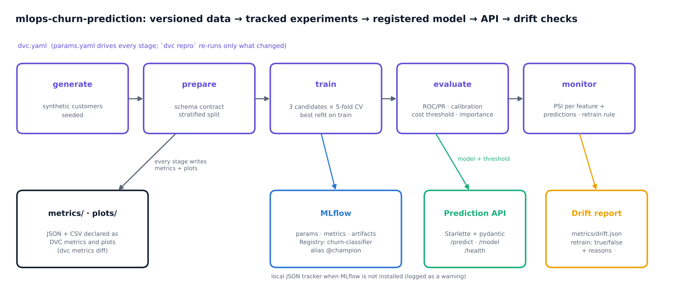
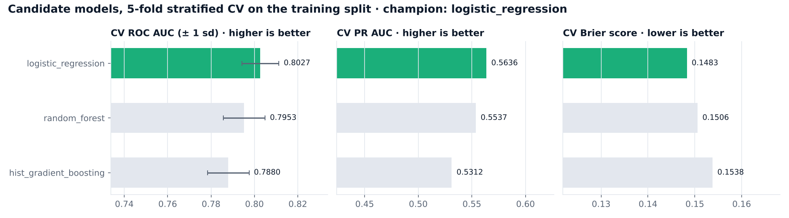
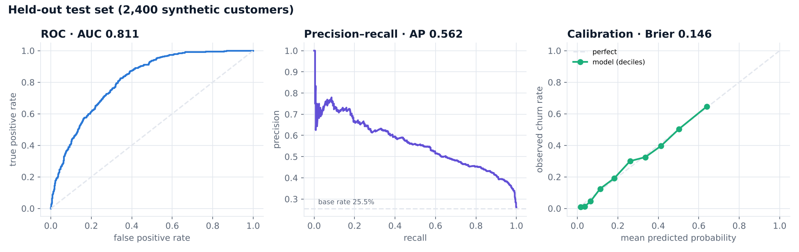
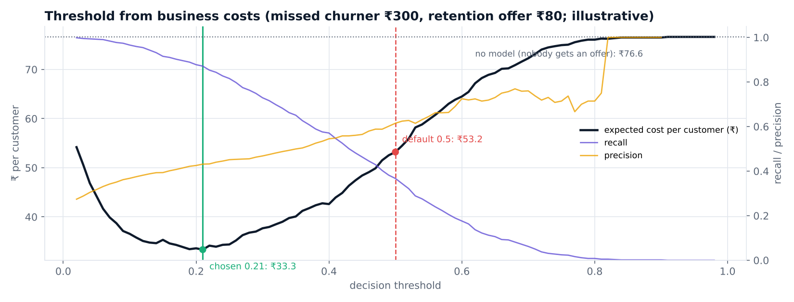
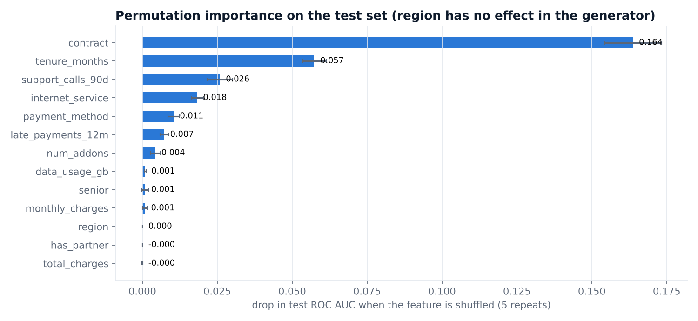
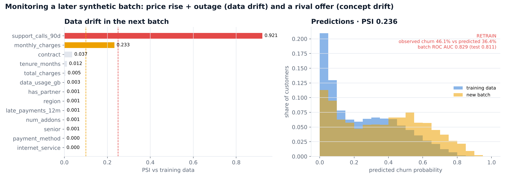

# MLOps Churn Prediction

[](https://github.com/vishavjit-singh/mlops-churn-prediction/actions/workflows/ci.yml)


A customer-churn model built the way a team can maintain it:

- a **DVC pipeline** (`generate → prepare → train → evaluate → monitor`) where `params.yaml` drives every stage and `dvc repro` re-runs only what changed
- **MLflow** tracking for every candidate, with the champion registered as `churn-classifier@champion`
- a decision **threshold chosen from business costs**, not left at 0.5
- a validated **prediction API**
- **drift monitoring** that decides when to retrain

The data is a **synthetic** telecom customer base generated with known churn drivers. That way, the model's findings can be checked against the truth.



## Why this project

| Problem in getting a model to production | How this repo handles it |
|---|---|
| "Which data and settings produced this model?" | Every stage is declared in [`dvc.yaml`](dvc.yaml) with its deps, params, outs, metrics and plots. The model metadata stores the SHA-256 of the training file |
| Experiments live in notebooks and nobody can compare them | Each candidate (logistic regression, random forest, gradient boosting) is a tracked run with params and 5-fold CV metrics. The best is refit, registered and given the alias `champion` |
| The API and the training code disagree on what a valid row is | One [`schema.py`](src/churn/schema.py) drives the prepare-stage checks and the API's pydantic model (ranges, allowed categories, unknown fields rejected) |
| A 0.5 threshold ignores what errors cost | `evaluate` sweeps thresholds and picks the one with the lowest expected cost (missed churner ₹300 vs retention offer ₹80, illustrative). The API serves that threshold |
| Accuracy hides a skewed base rate | ROC AUC, PR AUC against the base rate, Brier score and calibration, lift in the top decile, and permutation importance |
| The world changes after deployment | `monitor` computes PSI per feature and on the predictions for a later batch. The retrain rule checks feature drift, prediction drift, the AUC drop and the calibration gap once outcomes arrive |
| A tool missing from one environment breaks the pipeline | Tracking sits behind a small interface: MLflow when installed, otherwise a local JSON tracker, with a warning in the log saying so |

## Results from the demo run

`make demo` runs the five stages with the same commands `dvc repro` runs, then renders these images from `metrics/` and `plots/`. The numbers come from 12,000 synthetic customers (25.6% churn) with a stratified 80/20 split.

**Candidate models, 5-fold CV on the training split.** The generator's true churn process is additive on the logit scale, so it's no surprise that logistic regression edges out the tree ensembles:



**Held-out test set.** Ranking, precision against the base rate, and calibration:



**Choosing the threshold from costs.** At these illustrative costs, the cheapest threshold is 0.21: it catches 87% of churners at 43% precision:



**What the model relies on.** Contract and tenure carry most of the signal. `region` has no effect in the generator, and the model gives it essentially none. The generator's price effect overlaps with internet service and add-ons, so `monthly_charges` itself adds little once those are known:



**Monitoring a later batch.** The synthetic batch has a price rise and an outage (data drift) plus a rival fibre offer (concept drift). Support calls drift strongly (PSI 0.92), and the model still ranks customers well (AUC 0.829). But it now under-predicts churn: 36.4% predicted against 46.1% observed. The calibration rule therefore asks for a retrain:



| Metric (test set, synthetic data) | Value |
|---|---|
| Champion | logistic regression (CV ROC AUC 0.803 ± 0.009) |
| ROC AUC / PR AUC (base rate 0.255) | 0.811 / 0.562 |
| Brier score | 0.146 |
| Top-decile lift | 2.53× |
| Cost-optimal threshold | 0.21: recall 0.871, precision 0.431, 51.6% of customers flagged |
| Expected cost per customer | ₹33.3 at 0.21 · ₹53.2 at 0.5 · ₹76.6 with no model |
| Next batch | 1 feature in alert (support calls), prediction PSI 0.236, AUC 0.829, observed 46.1% vs predicted 36.4% → **retrain** |

> All data is **synthetic** ([`generate.py`](src/churn/generate.py), seeded), and the costs are illustrative. Every number above is in `metrics/*.json` after `make demo`.

## Quickstart

```bash
git clone https://github.com/vishavjit-singh/mlops-churn-prediction.git
cd mlops-churn-prediction
python -m venv .venv && source .venv/bin/activate
make install
make demo        # generate → prepare → train → evaluate → monitor → charts → summary
make test        # 32 tests
make serve       # API on http://127.0.0.1:8000
```

### With DVC and MLflow

```bash
make install-mlops                       # mlflow + dvc, and the package in editable mode
export CHURN_TRACKER=mlflow MLFLOW_TRACKING_URI=sqlite:///mlflow.db
dvc repro                                # runs only the stages whose deps or params changed
dvc metrics show                         # metrics/*.json
dvc params diff                          # after editing params.yaml
mlflow ui --backend-store-uri sqlite:///mlflow.db
```

Change `train.candidates.random_forest.max_depth` in `params.yaml` and `dvc repro` re-runs `train`, `evaluate` and `monitor` but not `generate` or `prepare`. `dvc.lock` is created by the first `dvc repro`.

### API

```bash
curl -s localhost:8000/model          # version, alias, threshold, test metrics, features
curl -s -X POST localhost:8000/predict -H 'content-type: application/json' -d '{
  "customer_id": "X1", "tenure_months": 3, "contract": "month-to-month", "internet_service": "fiber",
  "payment_method": "cash", "monthly_charges": 120, "total_charges": 360, "support_calls_90d": 4,
  "data_usage_gb": 80, "num_addons": 0, "late_payments_12m": 2, "senior": 0, "has_partner": 0, "region": "north"}'
# → {"model_version": "1", "threshold": 0.21, "customer_id": "X1", "churn_probability": …, "will_churn": true, "risk": "high"}
```

Send `{"customers": [...]}` (up to 1,000) for batch scoring. Validation errors return `422` with the field path. `docker compose up --build` serves the same API from an image that trains the model at build time.

## Project structure

```
├── dvc.yaml · params.yaml        # the pipeline and every tunable number
├── src/churn/
│   ├── generate.py               # synthetic customers with known drivers (+ drifted batch)
│   ├── schema.py                 # the input contract shared by prepare and the API
│   ├── features.py               # ColumnTransformer + candidate estimators
│   ├── stages.py                 # generate · prepare · train · evaluate · monitor
│   ├── tracking.py               # MLflow tracker / local JSON fallback, registry + alias
│   ├── monitoring.py             # PSI, retrain rule
│   ├── api.py                    # Starlette + pydantic prediction service
│   ├── report.py · cli.py
├── tests/                        # 32 tests: schema, stages end to end, threshold, PSI, trackers, API
├── Dockerfile · docker-compose.yml · Makefile
└── .github/workflows/ci.yml      # tests + demo · dvc repro with MLflow · Docker smoke test
```

## Testing

```bash
make lint && make test
```

- **Contract:** missing columns, duplicate IDs, out-of-range values and bad labels fail; unseen categories are reported rather than treated as fatal
- **Pipeline end to end** (temporary project root): every declared DVC output exists, metric files are flat numbers that `dvc metrics` can read, the split is stratified and disjoint, the champion is the best CV candidate, the cost threshold beats 0.5, importance finds the true drivers and ignores `region`, and the monitor flags the drifted batch
- **Threshold and PSI:** the cost optimum moves the right way when costs flip, precision is undefined when nothing is flagged, and PSI handles a constant reference and new categories
- **Tracking:** the local registry numbers versions and moves the alias. `MLflowTracker` is checked against a fake `mlflow` module (the real library runs in the CI `mlops` job). The automatic fallback logs a warning
- **API:** single and batch predictions match the model artifact, missing optional values are imputed, and validation, batch-size and malformed-JSON errors are handled

## Limitations and roadmap

- MLflow and DVC were not installable where this was built. Locally the pipeline ran with the JSON fallback tracker and the stage commands were run directly. The MLflow and DVC path (`dvc repro`, registry and alias) first runs in the CI `mlops` job, as does the Docker build.
- The API uses Starlette, the ASGI toolkit FastAPI is built on, because FastAPI could not be installed in that environment either. Swapping it in later only touches `api.py`.
- The data is synthetic, so real churn data will be messier and the numbers here are not a benchmark.
- Next: a DVC remote for the data, `dvc exp run` sweeps, promotion to `champion` only when a challenger beats it on the same test set, and scheduled monitoring that opens an issue when `retrain` is true.

## Author

**Vishavjit Singh Saini**, Data Engineer
[Portfolio](https://vishavjit-singh.pages.dev/) · [LinkedIn](https://www.linkedin.com/in/vishavjit-singh-7011211ab/) · [GitHub](https://github.com/vishavjit-singh)

## License

[MIT](LICENSE)
